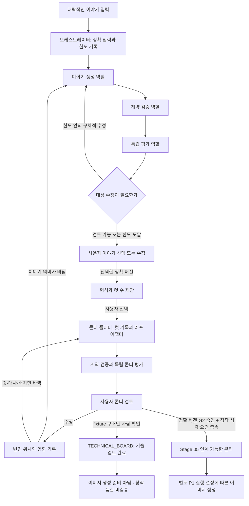

# P0 구현 기준과 첫 작업 범위

작성일: 2026-10-14. 근거: 사용자의 “p0 기준을 권고안으로 정리하고 구현을 재개해” 지시와 D-0035. 사용자는 요구에 맞는 기술 선택을 위임했다. 아래 반복 횟수·지원 모드·계약 확장 방식은 그 위임에 따라 채택하는 **엔지니어링 권고안**이며, 사용자가 숫자 하나하나를 직접 선택했다는 뜻은 아니다.

이 문서는 [제품 방향](product-direction-revision.md), [결정 팩](preimplementation-decision-pack.md), Stage 01–04·07 명세의 남은 P0 선택을 이번 구현 범위에서 구체화한다. 이전 문서의 “구현 보류”, “P0 추천 미수락”은 D-0035 이전 상태다. 사용자 창작물 승인, 모델 실행, 실제 프로젝트 제작은 각각 별도 범위다. 체크리스트의 기준 채택과 구현·검증 통과를 혼동하지 않는다.

## 1. 구현할 제품과 순서

**제품 목표:** 개인용 로컬 작업 공간 하나에서 대화로 프로젝트와 캐릭터를 정립하고 이야기를 만들며, 전문 역할의 작업과 결과·수정 이력을 오케스트레이터가 관리한다. 화면은 흰색 기반으로 단순하게 구성하고, 내부 승인 코드·도구 명세는 필요할 때 펼쳐 볼 수 있게 한다.

| 구분 | 이번 선택 | 완료로 부를 수 있는 범위 |
|---|---|---|
| 실제 사용 여정 | 최소 프로젝트 생성 → 자료 용도 확인 → 독립 캐릭터 창작 → 시리즈 방향 → 이야기 → 이야기 선택 → 형식·컷 제안 → 콘티 검토 → 이미지 초안 → 사람 수정·검수 | 전 단계 구현 및 각 실행 허가가 갖춰진 뒤 실제 제작 가능 |
| 첫 구현 단위 | Stage 04 이야기·콘티 하네스와 단일 작업 화면, 로컬 상태·버전·사람 정지/재개 | 합성 fixture로 입력 계약, 역할 전달, 버전 변경, 사람 확인과 복구 동작을 검증하는 기술 슬라이스. 사람이 구조를 확인하면 기술 흐름은 종료 가능 |
| 합성 선행 자료 | 정확 버전이 있는 예시 프로젝트·자료·캐릭터·시리즈 package | 개발용 선행 자료. 실제 캐릭터 창작 단계 완료나 실제 작품 승인 증거로 쓰지 않음 |
| 이야기/그림 품질 | 기술 경로와 창작 경로의 결과 종류를 표시 | fixture 출력·결정론적 그림·텍스트 콘티는 모델 품질 검증이나 유용한 시각 콘티 수용 증거가 아님 |
| 목표 장비 | 현재 PC를 이미지 생성 최소 사양으로 고정하지 않음 | GPU가 필요한 후보의 목표 작업 PC와 요구 사양은 P1 평가에서 선택 |

모델 호출이 없는 첫 fixture 경로에서는 `B`가 시각 창작 완료에 도달하지 않는다. 사람이 결과 구조를 확인하면 별도의 `TECHNICAL_BOARD` 결정으로 기술 흐름을 완료한다. 그 결정은 `G2`를 기록하지 않으며 결과에 `usable_storyboard = false`, `generation_ready = false`, `creative_quality_verified = false`를 유지한다. 기술 과정을 종료하는 것과 시각 콘티·이미지 제작을 진행할 수 있는 것은 각각 표시한다.

## 2. 계약 확장과 호환

기존 `mvp-records-v1.schema.json`의 의미·required 필드·fixture와 `/api/projects` 계약을 바꾸지 않는다. 새 작업 공간은 **독립 `schema_id = toon-studio-contract-v2`, `schema_version = 2.0.0` 계약과 `/api/studio` API**로 추가한다. URL에 버전을 새로 붙여 기존 라우트를 바꾸는 방식은 사용하지 않는다. 실제 첫 Pydantic 계약은 `backend/studio_contracts.py`가 정의하며 JSON Schema는 `studio_schema()`로 내보낸다.

- v1의 완전한 Project Brief를 새 프로젝트 생성 화면에서 요구하지 않는다. v2 최소 입력과 v1 record는 서로 다른 계약이다.
- v1 입력을 v2로 읽어야 할 때는 원본과 schema version을 그대로 보존하고, 명시적 변환 정의 및 결과 검증을 남긴다. 누락 정보를 가정해 채우거나 기존 승인 기록을 새 버전에 복사하지 않는다.
- artifact 내용 버전, record schema version, 실행/job의 정수 `revision`은 서로 다른 값이다. revision은 동시 수정·오래된 요청을 구분하며 artifact의 정확한 원본 버전을 대신하지 않는다.
- 입력은 `project_id + artifact_id + version`을 지정한다. v2의 `source_versions`가 각 source의 `role`도 기록하며, 선행 합성 package는 프로젝트 `fixture_versions`로 묶는다. schema version은 Project/Run 및 해당 계약 정의에서 확인한다. 내부 실행에서 가변 `latest`로 바꾸지 않는다.
- version 내용과 사람 결정은 append-only다. 현재 화면을 위한 선택 포인터·상태 projection은 갱신할 수 있지만 이전 원본과 결정을 덮어쓰지 않는다.
- studio 기록과 체크포인트는 기존 v1 저장 영역과 구분한다. studio 전용 `studio/studio.sqlite3`는 projection·이벤트·버전 snapshot을, `studio/checkpoints.sqlite3`는 LangGraph 체크포인트를 보존한다. **기존 백업 기능이 새 studio 작업 공간 전체를 내보내고 복원한다고 주장하지 않는다.** 전체 이식·암호화 백업 지원은 후속 Stage 08 작업 및 검증 대상이다.

다음 표는 studio 계약의 최소 의미와 후속 창작 계약의 필드 요구를 정한다. 이번 Stage 04 슬라이스가 모든 선행 단계의 실제 생성 UI나 rich creative field를 완성했다는 뜻은 아니다. 첫 코드의 핵심 타입은 `Project`, `ReferenceUse`, `CharacterPackage`, `SeriesPackage`, `StoryArtifact`, `FormatProposal`, `StoryboardArtifact`, `Run`, `Approval`이다. 현재 `Beat`는 action/emotion/dialogue/visual_purpose를, `Panel`은 scene/action/expression/dialogue/camera/background/composition/visual_purpose/gaze_target/pacing/text_placement/continuity를 명시한다. text object 분리·세부 상태 변화·full visual asset/coverage 계약은 모델/실제 제작 경로를 추가할 때 확장 및 검증한다. 실제 코드가 지원하는 필드·검사 및 검증 결과는 [구현 검증 기록](implementation-validation.md)에 따로 남긴다.

| 계약 | 최소 기록 | 반드시 지킬 의미 |
|---|---|---|
| 공통 envelope | `project_id`, `artifact_id`, `version`, `schema_version`, 생성 주체·시각, 정확한 `source_versions`, 합성/모델/사람 제작 구분, 위험·다음 소비자 | 프로젝트 경계와 artifact 내용 버전 고정. unknown은 허가나 승인으로 쓰지 않음. Project/Run과 artifact의 필드를 구분해 해석 |
| 프로젝트 | `name`, `audience`, `series_direction` | 생성 화면은 이 세 입력만 요구. 캐릭터·소재·톤·에피소드 제목·형식·컷 수는 이후에 정함 |
| 레퍼런스 | stable ID, 파일/텍스트 출처, 용도(캐릭터/시각 구성/이야기 원자료), 허용 범위·금지사항, 관찰과 결과 영향 연결 | v2 purpose 값은 `character`, `story`, `composition`, `dialogue`, `format`. “자료 없음”도 명시적 경로. 이야기 원자료는 썰·관찰·사용자 대본을 포함. 자료를 넣는 것과 모델 전송 허가는 구분 |
| 캐릭터 | stable character ID, 참고 버전, 대화·요청/수정 기록, 정체성 불변 요소·허용 변화·금지 요소, 행동·말투, 바이블, 시트 asset 참조와 coverage 확인, 사람 선택 기록 | 별도 Stage 02 작업. 실제 에피소드는 사람이 선택한 정확한 바이블·시트가 필요. 시트 수량을 자동 확정하지 않음 |
| 시리즈 | stable series ID와 버전, 대상·반복 방향, 캐릭터 정확 참조, 선택 후보·이유와 사람 결정 | 프로젝트 기본 방향과 확정된 시리즈 버전은 구분. 실계정 정보·게시 자동화 없이 시작 가능 |
| 에피소드 입력 | stable content ID, 원문·입력 종류, 보존할 표현/사실, 요청한 수정 범위, 대화 이력과 unresolved 질문 | 제목·형식·컷 수를 필수 입력으로 두지 않음. 이미 있는 이야기는 요청 밖의 내용을 임의 개작하지 않음 |
| 이야기 | premise·의도·끝맺음, ordered beats, action, purpose, 상태 변화, 정보 의존, text objects와 status, 정확 source refs | 추상적인 방향 이름만으로 후보를 만들었다고 하지 않음. G1은 선택한 이야기의 정확 버전에 결속 |
| 형식 제안 | 정확 G1 story ref, 제안 형식·컷 수·근거·대안·사용자 선택 | 이야기 선택 전 콘티 플래너 실행 금지. 이야기 의미가 바뀌면 새 이야기 및 G1 재확인 |
| 콘티 | ordered units, beat/text 연결, `visual_purpose`, scene, action, expression/pose, camera/focal point, `gaze_target`, props, continuity, `pacing`, text/layout/safe area, 생성 경계, 러프·전체보기 참조 | 컷마다 전달 정보와 관찰 가능한 행동·표정·구도를 기록. 추상적인 분위기와 카메라 라벨만으로 대체하지 않음 |
| 러프·평가 | output role, 정확한 story/character/board source refs, 제작 종류, asset 참조, criterion/version, 컷·비트·텍스트 위치, severity, 증거와 수정안, unresolved | pre-G2 러프는 Stage 04 산출물. post-G2 이미지 초안과 구분. Issue는 기술 진행 blocker와 실제 창작/생성 인계 blocker의 scope를 구별. evaluator 결과는 사람 승인 아님 |
| 피드백·결정 | feedback ID, 대상 artifact/version과 위치, 요청 범위·이유, changed IDs, preserved refs, 영향 단계, `supersedes`; gate·decision·actor·time·정확 대상 version | G1 story 결정, 기술 보드 구조 확인 `TECHNICAL_BOARD`, 실제 G2 storyboard 결정은 구분. 첫 Approval의 scope는 `synthetic_technical_review`이며 실제 작품 승인이 아님. 승인된 이야기 수정은 해당 G1을 다시 열고, 승인된 보드 수정은 해당 검토를 다시 열어 새 버전 확인 |

## 3. 역할과 한도

LangGraph를 첫 오케스트레이션 기술로 둔다(D-0031). 첫 기술 구현은 아래 **4개 전문 역할을 감독하는 하나의 오케스트레이터**로 구성한다. 역할은 모델 개수나 별도의 사용자 화면 개수를 뜻하지 않는다. 여러 역할이 같은 런타임을 쓰더라도 입력·지시·출력·권한은 구분한다.

| 역할 | 맡는 일 | 넘기는 결과와 제한 |
|---|---|---|
| 오케스트레이터 | 정확 입력 고정, 실행 상태·예산·횟수, 다음 역할, 사람 정지/재개, 실패·피드백 영향 관리 | 현재 결과·진행 요약·다음 행동. 창작 선택·승인·권리 판단 권한 없음 |
| `story_generator` | 사용자 의도를 보존한 구체적 사건·비트·대사 후보와 범위별 수정 | story draft와 변경 근거. 스스로 G1 승인하지 않음 |
| `storyboard_planner` | 선택된 이야기의 형식·컷 연결·연기·구도·페이싱 결정. 시각 러프 renderer/adapter와 연결 | format/board draft와 정확한 원본 참조. fixture renderer는 창작 시각 산출물 아님 |
| `evaluator` | 생성 역할과 분리된 지시로 이야기·콘티를 각각 평가 | criterion/rubric 버전·문제의 source/target 위치·관찰 증거·심각도·수정안을 구조화. 점수로 사람 선택을 자동 통과시키지 않음 |
| `validator` | schema·버전·프로젝트 경계·필수 필드·beat/text coverage·결정 참조·알려진 배치 조건 검사 | 검사별 passed/failed/blocked. 독창성·창작 품질·권리 적합성을 확정하지 않음 |

초기 정책의 구현 기본값은 `초기 초안 + 자동 창작 수정 최대 2회`, `일시적 기술 실패 재시도 최대 1회`다. 카운터는 별도이며 기술 retry가 창작 재생성이 되거나 한 카운터를 소진해 다른 카운터가 초기화되어서는 안 된다. fixture 작업에도 deadline과 최대 step 수를 적용하고, 종료 상태와 마지막 보존 결과를 보여준다. 숫자 시간·모델 호출·비용 제한은 모델 실행 전에 P1에서 구체화한다.

자동 수정은 evaluator가 대상과 근거를 지정한 경우에만 수행한다. 한도 도달, 평가 개선 정체, 평가 충돌, 불명확한 수정 범위, 누락 승인, 미지원 계약·텍스트 모드, 프로젝트 불일치가 생기면 작업을 멈추고 사용자에게 결과와 다음 선택을 보여준다. schema 오류·지원하지 않는 버전은 기술 retry 대상으로 삼지 않는다. 시각 러프가 없다는 `production` 범위 문제만으로 합성 구조 검토까지 영구 대기시키지는 않는다. 그런 결과는 사람이 `TECHNICAL_BOARD`로 확인하고 종료할 수 있지만 실제 창작 G2·생성 인계는 계속 불가하다.

사람 피드백은 즉시 새 대기 버전과 영향 기록을 만든다. 대사 수정은 해당 text와 배치 검사, 행동/표정/시선 수정은 해당 컷 및 인접 연속성, 컷 순서·페이싱 수정은 beat 매핑과 전체보기까지 갱신한다. 의도·전환·끝맺음 변경은 이야기와 G1부터 다시 확인한다. 변경하지 않은 부분은 정확한 이전 참조를 유지한다. 같은 요청을 retry하며 새로운 사용자 요청인 것처럼 한도를 리셋하지 않는다.

사람은 대기 결과에서 **선택/수정/반려**, 실행 중 **일시정지/취소**, 보존된 결과에서 **재개/명시적 새 시도**를 할 수 있다. 반려 결과·실패 attempt는 삭제하지 않는다. 중복 요청은 같은 작업으로 처리하고, 동시 수정은 예상 revision을 확인해 충돌을 알려준다. 실제 구현한 제어만 UI에 노출한다.

## 4. 시각 콘티와 텍스트 정책

읽을 수 있는 Level 1 러프와 컷별 설명을 기본 목표로 삼는다. 러프는 캐릭터의 행동, 읽을 수 있는 포즈·표정, 배치, 사건의 초점, 앞뒤 컷 사이에 달라진 정보를 보여야 한다. 전체보기에서 이야기 순서·전환·끝맺음을 판단할 수 있어야 한다. 세밀한 작화는 선택된 컷의 불명확한 정보만 보충한다.

텍스트만 있는 보드, 도형/막대기 fixture, 카메라 이름을 붙인 카드, 원문을 반복하는 결정론적 story 결과는 **기술 시험 자료**로 표시한다. 이 자료의 유효한 schema·성공 checkpoint·사람 `TECHNICAL_BOARD` 결정을 “창작 콘티 완료”로 표시하지 않는다. 첫 UI는 실제 모델/시각 renderer가 아직 없으면 그 상태와 필요한 다음 작업을 보여준다. 기술 검토 완료 뒤에도 생성 준비·창작 품질 플래그는 false다.

한국어 텍스트는 **별도 overlay**를 최초 지원 경로로 선택한다. 글자 내용·화자·순서·상태·자리와 그림 지시는 분리한다. 이번 위임 기준에 따라 새 패키지는 overlay를 명시한 제안으로 만들고, 사람이 이야기·형식·콘티를 확인할 때 그 모드도 보이게 한다. 기존 또는 들어온 패키지가 `in_image`, `mixed`, `unknown`이면 미지원 blocker로 기록하고 원문과 모드를 보존한다. 자동 overlay 전환, 승인된 문구 변경, 글자 생성 성공 추정은 하지 않는다. 추후 다른 모드를 지원하면 별도 계약·검사와 재검토를 추가한다.

시각 콘티의 창작 수용 기준은 다음과 같다. 실제 그림 평가와 사람 판단은 P1 후보 실행 뒤에 수행하며, 이 표가 평가 완료 기록은 아니다.

| 기준 | 검토할 구체적 증거 |
|---|---|
| 사용자 이야기 반영 | supplied material·요청 범위와 각 beat 대응, 임의 추가·삭제 위치 |
| 서사 | 원인과 반응, 기대와 변화, 전환·끝맺음이 비트/컷에서 드러나는지 |
| 캐릭터 | 바이블의 정체성·행동·말투 및 컷 사이 같은 캐릭터로 읽히는지 |
| 연기와 시각 목적 | 행동·포즈·표정·시선 대상·초점이 intended beat를 전달하는지 |
| 읽기 흐름과 페이싱 | 방향·위치·소품 연속성, reveal/reaction의 배치, 컷을 나누거나 합친 이유 |
| 텍스트와 공간 | 대사 위치·순서·읽을 수 있는 크기·잘림·시각 핵심의 가림 |

P1 창작 평가 피드백은 `blocker`(필수 전제·의미/안전한 인계 불가), `major`(이야기 이해·정체성·행동/읽기 흐름 문제), `minor`(의도는 읽히지만 국소 개선 필요)를 구분한다. 무모델 fixture의 결정론적 검사와 모델에 의한 독립 creative evaluation을 결과에 구분한다. 옵션 모델 역할을 구현할 때는 이야기 생성 prompt와 다른 평가 prompt를 사용하고 rubric/criterion, source artifact version, beat/panel/text 대상 위치, 관찰 증거와 보존·수정 범위를 기록한다. validator의 형식/관계 검사를 모델 평가라고 이름만 바꾸지 않는다. 위치 없는 “퀄리티가 낮다”는 자동 수정 지시로 사용하지 않는다. 모델 평가는 근거가 있는 조언으로 남기며 창작 승인권은 사람에게 있다.

## 5. 한 작업 공간의 화면 요건

상단에는 프로젝트와 현재 단계를, 본문에는 대화와 최신 결과를, 결과 옆에는 사용자 다음 행동을 둔다. 진행·사람 대기·중단·실패를 구별하고 “어떤 입력으로 어떤 역할이 작업했고 무엇이 나왔는가”를 짧게 설명한다. 기술 세부·전체 이벤트 기록은 접어서 둔다.

- 시작: 프로젝트 이름·독자·잠정 시리즈 방향만 입력한다.
- 이야기: 아이디어/썰/대본을 자유롭게 입력하고 결과와 함께 이어서 수정한다. 제목·컷 수 요구를 앞세우지 않는다.
- 선택: 사용자가 이야기를 선택한 뒤에 형식·컷 수를 제안한다. 시리즈와 캐릭터는 정확한 선행 버전으로 표시한다.
- 피드백: 새 버전과 바뀐 위치·이유를 즉시 보여주고, 선택/승인된 이전 결과도 확인할 수 있게 한다.
- 기술 fixture: 결과의 종류와 제한을 보이는 곳에 적고, 창작 시각 결과가 준비됐다는 완료 문구를 쓰지 않는다.

## 6. 기술 수용 조건과 P0 상태

아래 체크는 **P0 기준을 정했다**는 뜻이다. 실제 통과 결과·명령·미실행 항목은 구현 검증 기록에서 따로 보고한다.

- [x] 사용자 여정과 Stage 04 기술 슬라이스의 산출물·경계를 위 1절로 정했다. 실제 에피소드 전 독립 캐릭터 단계는 필수다.
- [x] Stage 01–04 계약 확장 방식과 필수 의미를 위 2절로 정했다. legacy v1 불변, additive studio 2.0.0 계약/API를 선택했다.
- [x] 역할·자동 수정/기술 retry 한도·사람 제어·피드백 영향·시각 요건·overlay 경로를 위 3–5절의 위임된 엔지니어링 기준으로 채택했다.
- [x] 아래 기술 수용 시나리오를 이번 구현 단위의 검사 기준으로 정했다.
- [x] 사용자에게 구현 재개 지시를 받았다. D-0035에 근거와 범위를 기록한다.

| 기술 수용 시나리오 | 통과 기준 |
|---|---|
| 기존 호환 | 기존 v1 schema/fixture/API 의미가 유지되고 새 작업 공간을 섞어 읽지 않음 |
| 역할 인계 | 합성 입력 정확 버전과 stage 역할 기록이 남고 validator와 evaluator 결과를 구분 |
| 이야기 우선 | G1 story 선택 없이는 형식/컷 콘티 경로를 진행하지 않음 |
| 사람 정지와 기술 종료 | story·board 대기에서 자동 진행이 멈춤. fixture 구조 확인은 `TECHNICAL_BOARD`로 기록하고 `technical_review_complete=true`로 기술 흐름만 완료. `G2` 기록·Stage05 ready 권한이 되지 않으며 `usable_storyboard`, `generation_ready`, `creative_quality_verified`는 false |
| 피드백 버전 | 이전 artifact·결정을 보존하며 새 버전·대상 위치·영향·재검토를 표시 |
| 입력/프로젝트 경계 | 다른 프로젝트, 미지원 schema, 오래된 revision, 잘못된 정확 참조는 명확한 오류/blocked로 종료 |
| bounded 작업 | 창작 수정과 transient retry의 한도를 따로 검증하고 소진·중단 시 마지막 결과/다음 행동을 보존 |
| pause/resume | 로컬 checkpoint로 사람 대기를 보존하고 프로세스 재시작 후 재개 가능. v1 전체 백업과 구별 |
| 중복/충돌 | 재개·피드백 중복은 중복 artifact 생성을 막고 경쟁 수정은 revision 충돌로 사용자에게 설명 |
| 텍스트 경계 | overlay는 별도 텍스트 책임을 유지하고 in-image/mixed/unknown은 자동 전환 없이 blocked |
| 화면 피드백 | 현재 단계·진행 상태·마지막 산출물·필요한 사용자 행동을 한 화면에서 읽을 수 있음 |
| 결과 종류와 issue 범위 | 합성 기술 검증 통과가 LLM 이야기 품질·시각 콘티·실제 이미지 생성 완료로 표시되지 않음. 실제 창작 시각 요건 미충족과 기술 구조 오류를 구별 |

## 7. 다음 범위와 남은 위험

**P1은 미결이다.** 사용자는 필요한 GPU/VRAM 사용과 외부 생성 비용·자료 전송을 이미 폭넓게 허용했다. 그 선호를 다시 묻지 않는다. 실제 호출 전에는 특정 작업, 현재 유효한 모델/워크플로·라이선스, 목표 로컬 PC(해당할 때), 선별 입력·제공자/보관 조건, 자격 증명 방식, 시간/횟수/총액 한도와 해당 범위 실행 허가를 구체화한다. D-0032의 USD 5는 아직 사용 가능한 비용 예산이 아니다. ComfyUI·ControlNet·IP-Adapter·Krita 연동은 이 첫 기술 슬라이스에 사용했다고 주장하지 않는다.

**P2 실제 제작은 미결이다.** 캐릭터 최소 계약은 위 2절로 정했으나 시트 실제 coverage·수량 및 생성/수정 흐름은 Stage 02 구현과 사람 확인이 필요하다. 플랫폼 기술 검증 뒤에도 실제 콘텐츠 사용은 별도 `content_execution` 지시와 정확한 캐릭터·시리즈·자료 기반이 필요하다.

남은 실질적 위험은 fixture 기반 하네스가 모델의 창작 능력·그림 품질·지연·비용을 증명하지 못한다는 점, rich contract의 모든 의미가 첫 API에 구현된 것으로 오해될 수 있다는 점, 새 studio 저장이 기존 백업/PC 이동 기능과 아직 완전히 연결되지 않았다는 점이다. 구현 보고에는 지원된 field/제어와 남은 기능을 적고, P1 창작 평가 및 Stage 02·05·08 후속 작업으로 각각 확인한다.
