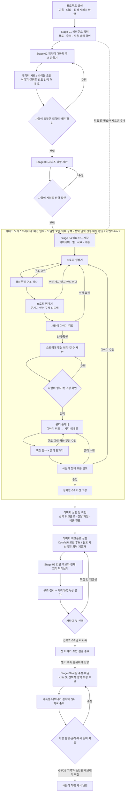

# 구현 재개 전 결정 팩

작성 기준: 2026-10-13 사용자 피드백, 초기 파이프라인 제안 문서, 하네스 에이전트 오케스트레이션 논의, 공식 도구 문서 검토.

## 0. 목적과 현재 상태

이 문서는 제품 방향 수정안 다음에 구현을 재개하기 전에 필요한 기술·운영 결정을 한눈에 검토하기 위한 묶음이다. 도구 비교와 추천은 선택지가 좁혀지도록 돕는 초안이다. **설치·연동·모델 선택 또는 구현 착수를 승인하지 않는다.** 미정 항목은 사용자 결정을 받거나, 승인된 합성 자료로 작은 비교를 거쳐 확정해야 한다.

- 기존 로컬 앱은 React/TypeScript/Vite, FastAPI/Python, SQLite를 사용하고 Pillow로 결정론적 MOCK 이미지를 만든다. 이 부분은 현재 프로토타입의 사실이지 창작 AI 파이프라인의 채택 기술이 아니다.
- 아래 AI/이미지 도구는 후보 또는 추천안이며, 현재 앱에 연결되어 있지 않다.
- D-0029가 추가 구현을 보류했다. 본 결정 팩과 [제품 방향 수정안](product-direction-revision.md)을 검토하고, 핵심 선택을 받은 뒤에만 새 범위와 수락 기준을 확정한다.
- 2026-10-13 사용자 답변을 반영했다: 프로젝트와 원본 자료는 로컬에 두고 로컬 추론을 우선한다. 품질·성능·하드웨어상 필요한 단계는 외부 모델 비용과 해당 입력 전송을 허용할 수 있다. GPU/VRAM 사용도 허용된다. 첫 기술 수직 슬라이스는 Stage 04로 정하고, 실제 에피소드 전에 별도 캐릭터 창작 단계를 제공한다.
- 이번 답변은 제품·기술 선택을 좁힌 것이며 구현 재개 지시나 실제 외부 API 호출 지시는 아니다. 구체적인 제공자·전송 자료·비용 한도와 제품 방향 수락이 정리될 때까지 구현은 계속 보류한다.

## 1. 먼저 합의된 제품 방향

| 항목 | 현재 피드백에서 정해진 방향 |
|---|---|
| 사용자 경험 | 개인용, 흰색 기반의 간결한 화면. 프로젝트별 한 작업 공간에서 순서대로 진행하고 현재 단계 하나에 집중한다. |
| 프로젝트 생성 | 프로젝트 이름, 독자/대상, 잠정 시리즈 방향만 받는다. 주인공, 소재, 분위기, 제목, 컷 형식과 컷 수는 뒤에서 정한다. |
| 캐릭터 | 외형 설명 입력란 하나로 끝내지 않는다. 레퍼런스와 원하는 특성을 대화로 모아 캐릭터를 창작하고, 사람이 다듬어 바이블·시트를 확정하는 독립 작업이다. |
| 이야기 | 아이디어·썰·관찰·기존 대본 중 편한 입력으로 시작한다. 대화하면서 이야기를 정리하고, 이야기가 먼저 잡힌 뒤 형식과 컷 수를 제안한다. |
| 레퍼런스 | 인물/캐릭터, 시각 구성, 이야기 원자료의 용도를 구분하고 각 결과에서 어떻게 쓰였는지 설명한다. |
| 피드백 | 수정·반려 의견은 새 버전으로 기록하고 영향받은 단계만 다시 작업한다. 이전 결과를 보존하며 내부 승인 코드는 일반 화면에 노출하지 않는다. |
| 오케스트레이션 | 플랫폼은 작업·자료·버전을 보여주는 껍데기가 아니라 간결한 작업면이고, 하네스가 정확한 입력으로 에이전트·도구·검증기·평가기를 연결한다. 창작 승인과 최종 판단은 사람에게 남긴다. |
| 데이터와 추론 위치 | 앱·프로젝트 DB·원본 자료는 로컬에 보관하고 로컬 추론을 우선한다. 필요한 경우 외부 생성 비용과 선별 입력의 전송을 허용하되, 어떤 제공자에 어떤 자료가 전달되는지와 비용 한도를 드러낸다. 모든 레퍼런스의 자동 업로드는 하지 않는다. |
| 하드웨어 | GPU/VRAM 사용이 허용된다. 현 PC는 기준으로 삼지 않는다. 목표 작업 PC를 지정한 뒤 그 기기의 사양·속도·품질로 로컬 경로를 평가하고, 필요하면 다른 PC로 옮긴다. |
| 구현 재개 | 제품 방향과 핵심 구현 전 결정을 확인하기 전에는 코드를 더 만들지 않는다. |

## 2. 단계별 진행 및 도구·AI 기법 제안

상태 표기: **현재 사용 중**은 기존 프로토타입 기록, **추천 후보**는 검토안, **미선택**은 추가 결정 전에는 설치·연동하지 않을 항목이다. D-0031의 LangGraph는 기록된 첫 슬라이스 기술 선택이며 구현 허가는 아니다. D-0032의 역할 수·반복 횟수·시트 수량·예산은 assistant 추천이다. 아래 사용자 여정은 향후 실제 사용 흐름이며, 첫 기술 슬라이스는 승인된 합성 입력으로 Stage 04 구간만 검증한다.

| 단계 | 사용자와 에이전트의 작업 | 후보 플러그인·오픈소스·AI 기법 | 사람의 확인과 결과 |
|---|---|---|---|
| 프로젝트 시작 | 사용자에게 프로젝트 이름·대상 독자·시리즈 방향만 묻는다. AI는 필요할 때만 방향을 짧게 되짚는다. | AI 호출 불필요. 현재 UI 기술인 React + TypeScript/Vite를 활용하되 화면을 단순화하는 것은 재설계 대상이다. | 프로젝트 기본값 저장. 세 항목은 나중에 대화로 수정 가능. |
| 레퍼런스 정리 | 파일이나 텍스트를 넣으며 용도(캐릭터/시각 구성/이야기 원자료)를 고른다. 비전 모델은 관찰 후보를 쓰고 출처 위치를 연결한다. | 멀티모달 LLM/VLM으로 설명·표정·구도·읽기 순서 등을 보조 분석. 초기 검색은 승인된 Markdown/JSON의 정확한 버전 참조(RAG-lite); 벡터 DB는 회수 실패가 확인될 때만 검토. | 출처·사용 범위·금지사항은 사람이 확인. 모델 설명은 관찰 초안이지 권리 판정이 아니다. `reference` 기록 생성. |
| 캐릭터 창작 | 대화로 성격·행동·말투·외형 단서를 모으고 개념 후보를 만든 뒤 시각 시트 후보를 생성한다. 사용자는 후보를 고치거나 선택한다. | 텍스트 LLM의 구조화된 출력(JSON Schema/Pydantic) + 확산 이미지 생성. 이미지 실행 후보는 ComfyUI. 구도/포즈 조건은 ControlNet 계열, 승인된 캐릭터 이미지 조건은 IP-Adapter 계열. 사람이 세밀하게 고칠 때 Krita + AI Diffusion 후보. | 한 후보를 곧바로 승인하지 않는다. 정면/측면/후면, 비율·실루엣, 색, 얼굴 단서, 표정/포즈가 검토 가능한 캐릭터 시트로 만들어 사람이 정확한 버전을 선택. 캐릭터 바이블·시트 생성. |
| 시리즈 방향 | 독자·프로젝트 방향·선택된 캐릭터를 읽고 반복 가능한 시리즈 후보를 소수 제안한다. | 역할 프롬프트를 분리한 LLM 생성·비교, 승인된 프로젝트 파일 검색. 초기엔 임베딩/pgvector 없이 버전 고정 검색. | 각 후보에 이야기 예시, 반복 가능성, 캐릭터 적합성, 제작 부담을 붙이고 사용자가 방향을 선택·수정. |
| 에피소드 이야기 | 사용자의 한 줄 아이디어, 썰, 관찰, 자료, 대본을 받고 대화로 의도와 빠진 핵심만 확인한다. 스토리 생성기가 구체적 사건과 비트가 있는 후보를 쓴다. | 구조화 스토리 생성, 입력 보존 범위 지정, 생성기/평가기 역할 분리, 근거가 있는 비판과 제한된 generate–evaluate–revise 루프. | 이야기의 실제 내용·인물 행동·감정 변화·전환·끝맺음을 검토. 제목과 컷 수는 강제하지 않는다. 사람이 이야기를 선택하거나 바꾼 뒤에만 레이아웃 제안으로 넘어감. |
| 형식·콘티 | 확정된 이야기에서 1컷/다컷 형식과 필요한 컷 수를 제안한다. 비트마다 행동·표정·시점·초점·연속성을 러프 썸네일로 보여준다. | 콘티 플래너 LLM; JSON Schema로 비트/컷 연결 검증; 그림 후보는 ComfyUI + ControlNet(스케치·포즈·윤곽 조건), IP-Adapter(프로젝트 캐릭터 조건) 비교. 거친 직접 스케치/수정은 Krita. | 평가기는 사용자 이야기 반영, 인과관계, 컷마다 달라지는 정보, 연기·구도, 읽기 흐름, 페이싱, 텍스트 자리, 캐릭터 연속성을 구체적 위치와 함께 지적한다. 사람은 전체 시퀀스와 결말을 승인/수정한다. |
| 이미지 초안 | 승인된 이야기·캐릭터 시트·콘티의 정확한 버전으로 컷별 후보를 만든다. 전체 순서 미리보기에서 캐릭터와 이야기 흐름을 확인한다. | ComfyUI를 이미지 그래프/실행 엔진 후보로 두고 API로 작업 제출·상태·결과를 연결. ControlNet은 행동·구도, IP-Adapter는 캐릭터 레퍼런스, 고정된 워크플로/시드/파라미터와 원본 입력의 provenance를 검토. | 컷별 선택·특정 컷만 재생성. VLM 평가는 참고 의견으로만 사용. 한국어 글자는 이미지 모델이 그리지 않고 분리된 레이아웃/텍스트 합성으로 다룬다. G3 의미에 해당하는 사람 선택은 보존. |
| 사람 수정·마감 | 사용자가 그림을 다듬고 대사를 배치한다. 필요할 때만 일부 영역을 보정한다. | Krita + AI Diffusion 후보, 인페인팅·영역 프롬프트·업스케일; 말풍선/글자는 별도의 결정론적 SVG/캔버스 합성 후보. | 원본 생성물을 보존하고 수정본 버전 생성. 잘림·가독성·해상도 같은 알려진 항목은 결정론적 검사, 표현·권리·최종 품질은 사람 판단. |
| 오케스트레이션(전 과정, Stage 07 지원) | 사용자가 결과를 보고 자연어로 이어서 말한다. 각 작업은 필요한 단계에만 보내고 답변 후 재개한다. | D-0031의 첫 기술 선택은 Python LangGraph이며, 체크포인트와 사람 입력에 의한 일시정지/재개를 검증한다. JSON Schema validator, append-only 작업 이벤트, 버전 고정 prompt/rubric, 제한된 재시도를 둔다. 지속 가능한 로컬 체크포인트와 복구가 과도하게 복잡하면 Python 명시적 상태 머신으로 단순화한다. n8n/Node-RED는 실제 외부 자동화 요구가 생길 때만 검토한다. | 오케스트레이터는 입력 버전·비용·횟수·시간 한도·재시도·중단·오류 복구·사용자 피드백을 관리한다. 생성/평가/검증은 승인 권한이 없다. 모델·플러그인·프롬프트·결과를 기록하고 기술 세부는 접어서 보여준다. |

Stage 01은 레퍼런스 정리, Stage 02는 캐릭터, Stage 03은 시리즈 방향, Stage 04는 에피소드 이야기와 형식·콘티, Stage 05는 이미지 초안, Stage 06은 사람 수정·QA/내보내기 준비에 대응한다. Stage 08은 로컬 저장·복구·Git 이동을, Stage 09는 검증된 기록의 기술 문서화를 지원한다. Stage 07–09는 사용자에게 별도 창작 단계로 진행을 강제하거나 에피소드 승인을 대신하지 않는다.

### 현재 가장 현실적인 선도 후보

1. **이야기/콘티 하네스:** 첫 기술 수직 슬라이스의 오케스트레이터로 LangGraph를 우선 채택한다. 단일 그래프에서 `스토리 초안 → 구조 검사 → 스토리 평가 → 제한된 재작성 → 사람 확인 → 콘티 초안 → 콘티 평가 → 사람 확인`을 정확한 버전으로 보존·중단·재개하고 로컬 DB와 복구 가능한지 확인한다. 체크포인트 운영이 이점보다 복잡하면 명시적 Python 상태 머신으로 축소한다. LangGraph가 자동으로 더 좋은 글을 보장하지는 않는다.
2. **이미지 워크플로:** ComfyUI를 재현 가능한 로컬 그래프/실행 API 후보로 평가한다. Krita AI Diffusion은 사람이 직접 선별·수정·인페인팅하는 표면 후보로 둔다. 두 도구를 함께 쓰더라도 설치·업데이트·노드 호환이 개인 사용자에게 과하지 않은지 확인한다.
3. **이미지 일관성 제어:** ControlNet은 포즈·구도 입력, IP-Adapter는 프로젝트 소유 캐릭터 레퍼런스 입력의 후보로 둔다. 둘 다 캐릭터 일관성이나 이야기 반영을 보증하지 않으므로 대표 컷에서 실제 결과로 비교한다.
4. **RAG와 데이터:** 시작은 프로젝트의 승인된 캐릭터/시리즈 JSON·Markdown을 정확한 버전으로 불러오는 검색으로 한다. 벡터 DB는 문서가 많아져 정확 버전 검색이 실패하는 문제가 생긴 후 검토한다.
5. **추가 학습:** LoRA 학습은 캐릭터가 승인되고 충분한 사용권한이 있는 제작 데이터가 쌓인 뒤의 선택지다. 초기에 넣지 않는다. n8n/Node-RED, PostgreSQL/pgvector, MinIO, DVC, Directus, 자동 게시 API도 현재 개인 로컬 MVP에는 기본 구성으로 넣지 않는다.

## 3. 전체 진행 플로우

평가 루프의 한도를 넘거나 입력 충돌·권리/버전 문제·모델 실패가 발생하면 다음 단계를 진행하지 않고, 사용자에게 현재 결과와 필요한 선택을 보여준다. 구조 오류도 재시도 한도 안에서만 고친다. 평가는 방향을 돕고 승인하지 않는다. 실제 게시 자동화는 이 범위에 포함하지 않는다.

이 그림은 전체 제품 여정이며 구현 순서와 다르다. 첫 기술 슬라이스는 합성 캐릭터/시리즈 버전을 읽어 Stage 04의 이야기→형식·콘티→G2 확인까지만 검증한다. 캐릭터 창작을 실제 사용에서 생략하는 경로가 아니다. 캐릭터 시트 생성, Stage 04의 생성형 썸네일, Stage 05 이미지 실행은 각각 실행 도구·입력·한도를 정하고 해당 실행 허가를 받아야 한다. Stage 04 계약 검증용 MOCK 썸네일로 창작 품질을 입증했다고 기록하지 않는다. Stage 06·게시 준비는 후속 범위다.

## 4. 구현 착수 전에 미리 정할 항목

DQ의 상태는 항목 전체를 한 번에 승인/미결로 처리하지 않고 아래처럼 부분별로 구분한다. **사용자 확정**은 다시 질문하지 않을 제약, **assistant 추천**은 수락 전 제안, **합성 평가 필요**는 실행 허가 후 증거로 좁힐 선택, **실제 작업 전 선택 필요**는 관련 설치·호출·실제 자료 사용 직전까지 정할 구체 값이다. 평가나 선택 필요가 모든 Stage 04 계약 구현을 막는다는 뜻은 아니다.

| DQ | 사용자 확정 / 기록된 결정 | assistant 추천 | 합성 평가 필요 | 실제 작업 전 선택 필요 |
|---|---|---|---|---|
| DQ-01 | 로컬 보관·로컬 추론 우선, 필요시 외부 비용·선별 전송 허용(D-0031) | 안내 UX의 구체 형태 | 전송 안내 이해도 | 제공자·전송 항목·보관 조건·자격 증명·실행 상한 |
| DQ-02 | 모델 미정 | 생성/평가 역할 분리 | 한국어 이야기·평가 품질, 동일 모델 분리 역할의 효용 | 정확한 모델/제공자·호출별/월 비용 한도 |
| DQ-03 | GPU 허용, 현 PC 비기준, Git으로 다른 PC 작업 허용(D-0033) | 휴대 가능한 설정 | 목표 PC에서 로컬 속도·품질·복구 | 로컬 모델 설치/평가 전 목표 OS/GPU/VRAM/저장공간·허용 시간 |
| DQ-04 | 모델 미정 | 기존 문서의 외부 모델명과 로컬 도구는 비교 후보 | 캐릭터·컷 의도·편집 가능성·실측 비용 | 유효한 모델 ID/버전·라이선스·전송 조건과 실행 허가 |
| DQ-05 | D-0031에 LangGraph 우선, Python 상태 머신 fallback 기록 | 구체 그래프/체크포인트 설계 | 중단·재개·로컬 복구 부담 | 해당 코드 작업 전 패키지/체크포인터 호환 계약 |
| DQ-06 | 유한 루프와 사람 판단 경계 | D-0032: 4역할·창작 수정 2회·일시 오류 재시도 1회 | 역할 효용·한도 도달·중단/복구 | 슬라이스 한도 정책 수락; 모델 실행 전 timeout·비용 상한 |
| DQ-07 | 실제 에피소드 전 독립 캐릭터 단계 | D-0032: 4뷰·표정 6·포즈 3, 사람이 보정 | 시트의 식별성·후속 생성 유용성 | 캐릭터 단계 구현 범위/최소 계약; 실제 정체성·스타일은 content_execution에서 |
| DQ-08 | 창작 승인과 정확 버전 선택은 사람 | D-0032의 위치 기반 이슈 분류/rubric | 이슈 근거·이야기/콘티 유용성 | Stage 04 수락 rubric; Stage 05/06 기준은 해당 범위 전 |
| DQ-09 | Stage 04 합성 기술 슬라이스 우선, 실제 사용 전 캐릭터 단계(D-0031) | 아래 P0의 완료 기준 | 하네스 기술 검증과 창작 품질 검증을 별도 보고 | 제품 범위 수락·별도 구현 재개 지시; 실제 자료는 별도 실행 전환 |
| DQ-10 | 수량/예산 미정 | D-0032: 러프 1개/컷·요청 컷 추가 1개·합성 총 USD 5 이하 | 이미지 시간·비용·후보 선택 UX | 이미지 실행 전 예산/시간/후보 수 수락; 실제 에피소드 상한 |
| DQ-11 | 로컬 저장·이력·격리 경계 유지 | D-0032: 필요한 요약/선택 이미지만 전송, 보관 조건 불명 시 중단 | trace 요약·복구·자료 제외 동작 | 실제 자료 전 보존/백업/삭제 범위; 외부 전송 전 제공자별 조건 |
| DQ-12 | 사람 게시와 자동 승인 금지라는 기존 경계 | 자동 예약/분석은 후속 검토 | 현재 슬라이스에서 평가 불필요 | 게시 자동화/성과 수집 확대 시 별도 결정 |

아래 표는 이 분류를 뒷받침하는 상세 검토안이다. D-0032의 숫자와 모델 후보는 사용자가 승인한 값으로 읽지 않는다.

| ID | 결정 사항 | 추천 출발점 | 막히는 작업 |
|---|---|---|---|
| DQ-01 | AI 추론 위치 및 자료 전송 | **결정됨:** 앱·DB·원본 자료 로컬 보관, 로컬 추론 우선, 품질·속도·하드웨어상 필요할 때 외부 생성과 선별 자료 전송 허용. 통합은 제공자·전송 항목·비용 한도·저장 정책을 명시하고 자동 전체 업로드를 금지 | 실제 제공자 연결 전 세부 전송 계약은 확정 필요 |
| DQ-02 | 텍스트/평가 모델 제공자와 한국어 품질, 월 비용 상한 | 모델 선택은 미정. 동일한 짧은 합성 이야기 과제를 로컬 후보와 유료 API 후보로 비교하고, 생성/평가 역할 분리가 실제로 필요한지 함께 확인 | 실제 이야기·콘티 에이전트 실행 |
| DQ-03 | 목표 작업 PC의 OS/GPU/VRAM/여유 저장공간과 이미지 작업 허용 시간 | **현 PC 사양은 설계 기준에서 제외됨:** 다른 고사양 PC로 이동해 작업할 수 있다. 목표 실행 기기는 아직 미정이며, 해당 PC의 사양과 허용 시간을 정한 후 로컬 이미지 경로를 평가한다. 그전에는 휴대 가능한 설치·설정 계약을 정리한다 | ComfyUI·Krita·모델 및 실행 한도 선정 |
| DQ-04 | 이미지 기반 모델/체크포인트와 결과의 사용 범위 | Gemini Nano Banana 2.1 유료 API와 OpenAI GPT Image 2는 비교 후보일 뿐이다. 최종 선택은 합성 샘플의 캐릭터 일관성·스토리 충실도·편집 가능성, 비용·전송 조건과 목표 PC에서 시험한 로컬 경로를 함께 비교한다 | 캐릭터 시트/콘티/초안 생성 |
| DQ-05 | Orchestrator 프레임워크 | **D-0031의 첫 기술 선택:** LangGraph로 Stage 04를 먼저 구성하고 로컬 체크포인트·중단/재개·정확 버전 전달을 검증한다. 지속성/복구 복잡도가 과도하면 단순 Python 상태 머신으로 축소 | 에이전트 루프 구현 전 패키지/체크포인터 호환 확인 |
| DQ-06 | 에이전트 역할 수, 평가 후 재작성 허용 횟수, timeout 및 비용 ceiling | **추천 기본값:** 논리 역할은 스토리 생성·콘티 계획·평가·결정론 검증의 4개. 첫 초안 뒤 창작 수정은 최대 2회, 일시적 기술 실패 재시도는 1회. 무한 반복 금지. 숫자 timeout과 provider별 비용 ceiling은 선택 모델 확정 때 설정 | 하네스가 멈추는 조건, 예상 비용 |
| DQ-07 | 캐릭터 시트의 최소 뷰/표정 수, 기준 스타일 및 사람이 직접 그릴 범위 | **추천 계약:** 바이블(욕구·두려움/약점·가치/금기·행동 규칙·말투) + 시각 기준(실루엣·비율·팔레트·변경 금지 단서) + 정면/3⁄4/측면/후면 전신 뷰 + 기본 표정 6종 + 대표 행동 포즈 3종. 생성 품질이 부족하면 사람이 보정하거나 직접 그리는 경로를 허용 | 캐릭터 생성 및 일관성 평가 |
| DQ-08 | 스토리·콘티·이미지 초안의 사용자 수락 기준과 비교 사례 | **추천 계약:** 단일 종합 점수 없이 근거가 있는 이슈를 `차단/수정 권장/선택 개선`으로 나눈다. 스토리는 사용자 의도·인과·인물 행동·감정 변화·전환/회수, 콘티는 컷별 시각행동·읽기 순서·페이싱·초점·연속성·대사 영역을 본다. 이슈는 beat/panel ID와 수정 제안을 붙인다 | 생성기/평가기 prompt와 품질 판단 |
| DQ-09 | 처음 구현할 전체 범위 | **결정됨:** 첫 기술 수직 슬라이스는 합성 캐릭터를 사용하는 Stage 04 이야기→콘티 하네스. 다만 실제 프로젝트/에피소드 사용 전에 레퍼런스 대화·캐릭터 창작·사람 수정·바이블/시트 확정 단계를 구현한다 | 슬라이스 수락 기준과 캐릭터 시트 계약 |
| DQ-10 | 컷별 후보 수, 이미지별 시간/비용 한도, 실패 시 수동 편집 경로 | **추천 기본값:** 저해상도 러프 1개/컷부터 시작. 사용자가 선택한 컷에만 요청 시 후보 1개를 더 만든다. 전체 에피소드 자동 재생성은 하지 않는다. 합성 평가 총액은 $5 이하로 제한하고 실제 에피소드별 금액 한도는 API 선택 후 정한다 | 목표 실행 환경별 처리시간·비용과 반복 UX |
| DQ-11 | 채팅/버전 이력에 보관할 민감한 사용자 스토리·이미지, 백업 범위 | **추천 기본값:** 원본 자료와 버전 이력은 로컬 저장 계약대로 보존한다. 외부 모델에는 해당 작업에 필요한 요약·선택 이미지·지시만 전송하고, 비밀/API 키·전체 채팅 원문·미선택 참고자료는 보내지 않는다. 학습 재사용을 명시적으로 제외하는 유료 조건을 우선하며, provider의 보관/삭제 조건이 확인되지 않으면 연결하지 않는다 | 저장·복구·하네스 trace 계약 |
| DQ-12 | 게시·성과 분석의 범위 | 사람의 수동 게시. Instagram API와 자동 예약/성과 수집은 후속 별도 결정 | 현재 Stage 01–06 구현에는 영향 없음 |

### 이번 답변으로 정해진 선택과 남은 결정

**사용자 답변으로 정해짐:** 개인용 로컬 앱/자료 보관, 로컬 추론 우선, 필요한 단계의 외부 생성 비용·입력 전송 허용, GPU/VRAM 사용 허용, Stage 04 이야기→콘티를 첫 기술 수직 슬라이스로 선택했다. 실제 에피소드 사용 전에 캐릭터 창작 여정을 제공한다. 이미지 생성 하드웨어는 현 PC를 기준으로 하지 않으며, 필요하면 Git으로 다른 PC에서 작업하는 방향이 허용된다.

**초기 기술 판단:** 첫 슬라이스의 오케스트레이터는 LangGraph로 시작한다. 체크포인트 저장·중단/재개·로컬 복구가 기존 Python/SQLite 기반과 자연스럽게 맞는지 확인하며, 복잡도가 이득을 넘으면 명시적 Python 상태 머신으로 단순화한다. 산출물·버전의 원본 기록은 기존 로컬 앱 저장 계약에 둔다.

**아직 정할 항목:**

1. 텍스트/평가/VLM 제공자·모델, 한국어 품질 비교와 월별 상한.
2. 이미지 후보의 합성 샘플 품질과 provider별 요청/보관 조건 비교. 기존 문서의 Gemini Nano Banana 2.1과 OpenAI GPT Image 2라는 후보 표기는 채택·가용성 확인 기록이 아니다. 실행 전 유효한 모델 ID와 조건을 재확인한다.
3. 캐릭터 시트·평가 기준·재시도 수는 제안된 기본값을 제품 방향과 함께 검토한다.
4. 실제 작업의 작업별 비용 상한과 선택 이미지 전송 안내 방식.
5. 모델/체크포인트/커스텀 노드 라이선스와 개인 사용 조건.

합성 모델 비교의 범위·예산·전송 경계는 [합성 모델·이미지 흐름 비교 계획](synthetic-model-evaluation-plan.md)에 정리했다. 합성 비교도 실제 API를 호출하는 실행 전환이므로 아직 실행하지 않는다.

모델명, 생성 단가와 정확한 런타임 버전은 합성 샘플과 선택된 목표 작업 PC를 평가할 때 확인한다. 소스/명세는 Git으로 이동할 수 있게 하고, 모델 가중치·캐시와 프로젝트 미디어는 Git에 자동 포함하지 않는다. 이번 선택만으로 구현 재개나 실제 제공자 호출이 시작되지는 않는다.

## 5. 도구별 확인 근거와 제한

Krita AI Diffusion과 ComfyUI는 후보 도구로만 남긴다. 로컬 관리형 서버의 요구 사양과 드라이버 조건은 작업 시점에 공식 설치 안내에서 다시 확인하고, 실제로 선택한 목표 PC에서 맞는지 평가한다. 현 PC의 GPU 정보는 이 결정에 사용하지 않는다. [Krita AI Diffusion 설치·하드웨어 안내](https://github.com/Acly/krita-ai-diffusion/blob/main/docs/src/content/docs/installation.mdx), [Krita AI Diffusion 저장소](https://github.com/Acly/krita-ai-diffusion).

ComfyUI는 노드 그래프와 API/백엔드를 제공하며 self-hosted API는 워크플로를 실행 대기열에 넣고 결과/오류 상태를 확인할 수 있다. 따라서 플랫폼에서 완성된 워크플로를 숨기고 “이 컷 다시 만들기”처럼 노출하는 설계와 맞는다. [ComfyUI 저장소](https://github.com/comfy-org/ComfyUI), [서버 API 경로](https://docs.comfy.org/development/comfyui-server/comms_routes).

LangGraph는 그래프 체크포인트와 human interrupt의 일시정지/재개 기능을 제공해 오케스트레이터 후보로 맞지만, 지속형 checkpointer와 운영 부담을 별도로 평가해야 한다. 현재 공식 Python 저장소는 MIT 라이선스로 표시되어 있다. [LangGraph interrupt 문서](https://docs.langchain.com/oss/python/langgraph/interrupts), [persistence 문서](https://docs.langchain.com/oss/python/langgraph/persistence), [저장소 라이선스](https://github.com/langchain-ai/langgraph/blob/main/LICENSE).

ControlNet은 포즈·선·깊이 등 조건 입력으로 생성 과정을 제어하고 IP-Adapter는 이미지 입력과 강도를 조절해 생성물을 유도할 수 있다. 이들은 방향을 제어하는 기법이지 결과의 서사·캐릭터 품질을 보장하는 기능은 아니다. [Diffusers ControlNet 문서](https://huggingface.co/docs/diffusers/main/api/pipelines/controlnet), [Diffusers IP-Adapter 문서](https://huggingface.co/docs/diffusers/en/using-diffusers/ip_adapter).

기존 검토안의 이미지 API 후보 표기는 Gemini Nano Banana 2.1과 OpenAI GPT Image 2다. 이번 통합 작업에서 모델 가용성·기능·가격·데이터 조건을 재검증하지 않았으며, 이 이름을 승인된 모델 ID나 견적으로 사용하지 않는다. 제품 선택은 합성 캐릭터/콘티 샘플의 의도 반영·연속성·수정 가능성·실측 비용으로 비교한다. 실행 전에 공식 문서에서 현재 모델 ID, 입력/출력 지원, 유료 조건, 학습 사용·보관/삭제 조건과 가격을 확인하고 평가 계획을 갱신한다. [Gemini 이미지 생성 안내](https://ai.google.dev/gemini-api/docs/image-generation), [Gemini API 가격](https://ai.google.dev/gemini-api/docs/pricing), [Gemini API 약관](https://ai.google.dev/gemini-api/terms), [OpenAI 모델 문서](https://developers.openai.com/api/docs/models), [OpenAI 가격](https://developers.openai.com/api/docs/pricing).

ComfyUI와 Krita AI Diffusion 저장소는 현재 GPL-3.0 표기를 사용한다. 개인 PC에서 별도 도구로 호출할지, 통합 설치본에 포함·재배포할지는 라이선스 영향이 달라질 수 있으므로 패키징 방식을 정할 때 다시 확인한다. 가중치·체크포인트·LoRA·커스텀 노드는 코드 라이선스와 별도로 각각 사용 조건을 확인한다. [ComfyUI 라이선스](https://github.com/comfy-org/ComfyUI/blob/master/LICENSE), [Krita AI Diffusion 라이선스](https://github.com/Acly/krita-ai-diffusion/blob/main/LICENSE).

도구 버전, 라이선스, 모델 요구 사양은 바뀔 수 있다. 구현에 들어가는 시점에 공식 원문을 재확인하고, 라이선스와 데이터 전송 조건을 결정 기록에 남긴다.

## 6. 구현 재개 게이트

### P0 — Stage 04 합성 하네스 구현 재개 전

- [ ] 제품 여정과 Stage 04 슬라이스의 산출물/제외 범위를 사용자가 수락했다(DQ-09). 실제 사용 전 캐릭터 단계는 이미 정해진 요구다.
- [ ] Stage 01–04 산출물 계약을 기존 MVP 스키마와 정합화했다. 최소 Project Brief, 레퍼런스 용도 연결, 캐릭터 대화·수정 이력·시트 확인, 수정된 이야기·콘티 필드 및 G1/G2 기록을 포함한다. 구현 전에 스키마 버전 또는 마이그레이션 작업을 기록한다.
- [ ] Stage 04 평가 기준, 시각 콘티 표현과 품질 기준, 피드백 위치·심각도, 역할 분담, 제한된 수정·재시도 및 중단 조건을 수락하거나 조정했다(DQ-06/08). D-0032의 숫자 기본값은 아직 추천이다.
- [ ] 기술 완료 조건을 합의했다: 합성 입력의 정확 버전 전달, 이야기 선택 후 형식 제안, G2 전 사람 정지, 피드백으로 새 버전/영향 표시, 로컬 체크포인트 중단·재개/복구, 한도 도달 시 미결 보고, 읽을 수 있는 결과·진행 요약. MOCK으로 검증한 동작과 모델로 평가한 창작 품질을 구분한다.
- [ ] 위 범위를 기록하고 사용자가 별도로 구현 재개를 지시했다. 이 문서 작성이나 검토 완료만으로 재개하지 않는다.

LangGraph와 로컬 우선 원칙을 다시 선택시키지 않는다. 패키지/체크포인터 호환은 재개 후 해당 코드 변경 전 확인한다. 제공자 호출 없이 합성 fixture/MOCK으로 계약을 구현하는 범위라면 이미지 모델, 목표 이미지 작업 PC, 시트 수량, USD 5 추천 예산은 P0 선결 조건이 아니다.

### P1 — 합성 모델 평가·이미지 실행 전

DQ-02/03/04/06/10/11: 평가할 역할과 샘플/rubric, 목표 로컬 PC(로컬 실행 시), 유효한 모델/워크플로·라이선스, 전송 항목·보관/삭제·자격 증명, 숫자 시간/횟수/총액 상한을 정하고 별도 실행 허가를 받는다. 외부 호출은 구현 재개와 별개다. 승인 전에는 [합성 평가 계획](synthetic-model-evaluation-plan.md)만 유지한다. USD 5를 포함한 D-0032 추천은 비용 사용 허가가 아니다.

### P2 — 캐릭터 단계 및 실제 에피소드 사용 전

DQ-07/08/11: 캐릭터 대화·사람 수정·바이블/시트의 최소 계약을 캐릭터 단계 구현 전에 수락한다. 실제 프로젝트/에피소드 전에는 그 단계가 사용 가능해야 하며, 플랫폼 수락과 별도 `content_execution` 지시, 정확한 캐릭터/시리즈/레퍼런스 버전·사용권·보존/백업 범위가 필요하다. 프로젝트별 정체성·스타일은 명세 단계에서 채우지 않는다.

### P3 — 후속 마감·게시 준비 전

Stage 06의 수정/QA/내보내기 범위와 사람 G4/G5 기록을 합의한다. DQ-12의 자동 게시·성과 수집은 현재 슬라이스를 막지 않으며 확대하려면 별도 결정한다.

## 7. 병렬 문서 통합 시 대조할 지점

이 작업은 두 문서만 수정했다. 아래는 다른 스레드가 수정하는 문서와의 **대조 대기** 항목이며, 통합 완료 주장이나 그 문서의 편집 요청이 아니다.

| 문서 | 통합 검토 항목 |
|---|---|
| Stage 01–03 | 프로젝트 생성 세 항목, 자료 용도/권리 확인, 캐릭터 독립 여정과 정확 버전 확인, 시리즈 사람 선택; DQ-07 수량을 승인된 기본값으로 만들지 않았는지 |
| Stage 04 | 이야기 먼저→형식/컷 제안, 읽을 수 있는 러프와 완전한 컷 기록, 제한 루프/G2, 합성 fixture 기술 검증과 창작 품질 검증 구분; DQ-06/08 추천 상태 |
| Stage 05–06 | 정확 G2/캐릭터 입력, 컷별 선택·부분 재생성·G3 종료, 후속 마감 G4/QA·권리 G5, 한국어 텍스트 분리; DQ-10 후보 수/예산 미승인 상태 |
| Stage 07–09 | 지원 작업이 창작 상태나 승인으로 오인되지 않는지; LangGraph/D-0031과 현 PC 비기준·Git 이동 경계; 검증된 결과만 문서화 |
| 합성 평가 계획·MVP 범위·기술 기준·운영 규칙 | P0/P1/P2가 섞이지 않는지, 모델 이름/가격은 재확인할 후보인지, mock 품질 주장·기존 Stage 01–05 동시 구현 요구가 남지 않았는지 |

통합 검토 결과:

- `synthetic-model-evaluation-plan.md`의 USD 5는 D-0032 추천값이며, 사용자 확인 전 실행 기본값이나 비용 승인으로 취급하지 않는다.
- Stage 04 G2 준비용 pre-G2 러프와 Stage 05 G2 이후 에피소드 이미지 초안은 별도 산출물·실행 범위다. pre-G2 생성형 러프도 decision pack의 P1 실행허가가 필요하고, Stage 05의 내부 `IG-C0`–`IG-C7` 평가 체크포인트는 그 허가를 대체하지 않는다. 기하학적 목업은 개발용 fixture일 뿐 창작 품질 수용 증거가 아니다.
- Stage 04의 텍스트 렌더링 모드가 미정이거나 Stage 05가 지원한다고 확인되지 않은 in-image/mixed 모드이면 자동 overlay 전환 없이 blocker로 둔다. `visual_purpose`, `gaze_target`, `pacing`은 정확한 원본 버전과 함께 Stage 05 prompt·검토 증거까지 전달한다. 별도 러프/평가 자료의 저장 스키마와 Stage 05 manifest 정합화는 남은 P0 계약 작업이다.
- `platform-mvp-scope.md`의 D-0027 순서는 역사적 구현 기준으로 표시하고, 현재 제안은 Stage 04 합성 수직 슬라이스 우선으로 갱신했다. 기존 로컬 저장·백업·격리 경계는 별도 변경이 없는 한 유지한다.
- Stage 07은 LangGraph를 첫 슬라이스의 오케스트레이션 선택으로, Python 상태 머신을 fallback으로 기록한다. 이는 영구 Stage 07 엔진 선택이나 구현 재개 승인이 아니다. D-0032 역할 수와 반복·재시도 수치는 추천 상태다.
- Stage 01–03과 Stage 04의 새 artifact fields는 기존 MVP 스키마와 정합화되지 않았다. 이를 구현 전 계약 작업으로 P0에 남겼다.

이 통합 검토는 문서 충돌을 표시하고 우선순위를 정리한 것이며, 미결 제품 선택이나 구현 재개를 사용자 대신 승인하지 않는다.
